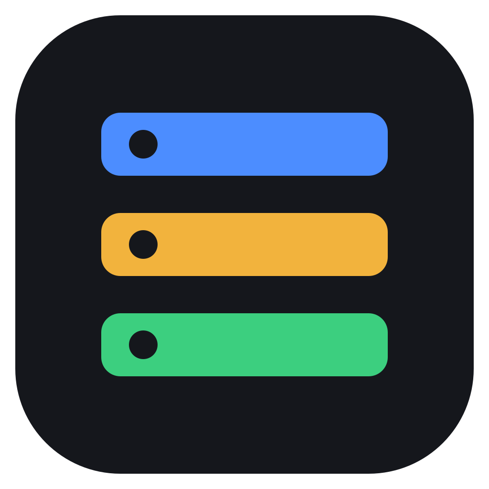
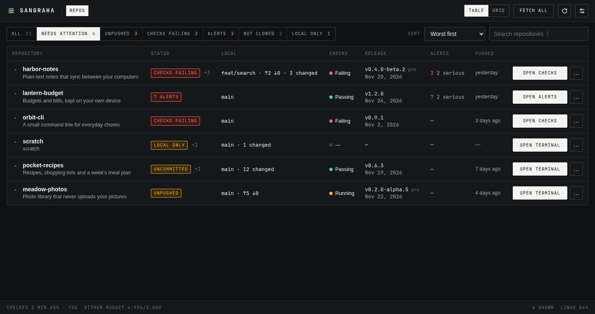
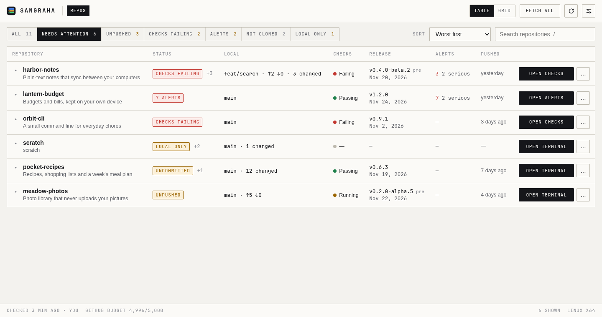
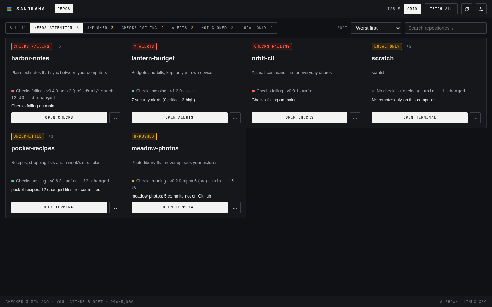
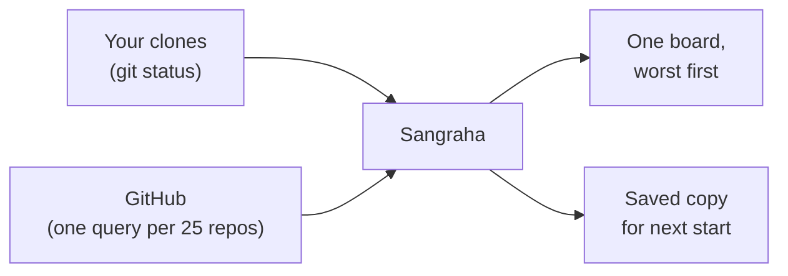

<div align="center">
  
  <h1>Sangraha</h1>
  <h4>See every GitHub repository you own, and every copy on your computer, on one board. Worst problems first.</h4>

  <p>
    
    
    
  </p>

  <p>
    <a href="#-what-it-does">What it does</a> •
    <a href="#-get-started">Get started</a> •
    <a href="#-how-it-works">How it works</a> •
    <a href="#-faq">FAQ</a> •
    <a href="#-for-developers">For developers</a>
  </p>

  
</div>

Sangraha ("collection" in Sanskrit) is for people who keep many repositories at once. It reads
GitHub and the clones on your computer together, and answers one question: *what needs me
today?* Failing checks, security alerts, commits that never reached GitHub and forgotten
changes all show on one board, worst first, each with one button that takes you there.

Sangraha is **alpha** software. It only reads: it never commits, pushes or changes your
files. There is no download yet; build it from source (below).

## ✨ What it does

- 🚦 **Worst first** – a red check or a serious security alert sits above a stray file. Each
  row has one status and one button for the next step (**Open checks**, **Open alerts**,
  **Open terminal**).
- 💻 **GitHub and your computer together** – each repository shows its clones: branch, commits
  ahead or behind, changed files, stashes. Two clones of one repository show as one row.
- 📤 **Unpushed work** – commits on any branch that are not on GitHub, and folders with no
  remote at all, so nothing lives on one laptop only.
- 🛡️ **Security alerts** – open alerts per repository (Dependabot), with how many are high or
  critical.
- 🏷️ **Latest release, pre-releases included** – GitHub's "latest release" skips
  pre-releases; Sangraha shows the newest one either way.
- 🔎 **Filters with counts** – *Needs attention*, *Unpushed*, *Checks failing*, *Alerts*,
  *Not cloned*, *Local only*. Search with <kbd>/</kbd>, refresh with <kbd>R</kbd>.
- 🔁 **Renamed repositories** – a clone whose remote still uses an old name is matched to the
  new one, and the row says so.
- 🙈 **Hide what you do not care about** – hidden rows stay one click away under *Hidden*.
- ⌨️ **Command line too** – `sangraha status` prints the same board in a terminal.

## 📸 Screenshots

<table>
  <tr>
    <td></td>
    <td></td>
  </tr>
  <tr>
    <td align="center">Table view, light theme</td>
    <td align="center">Grid view, dark theme</td>
  </tr>
</table>

The screenshots use made-up demo repositories.

## 🚀 Get started

There is no installer yet. Until the first release, build Sangraha on your own computer.

1. **Install the tools.** You need [Rust](https://rustup.rs), [Node.js](https://nodejs.org)
   22 or later, `git`, and the [GitHub CLI](https://cli.github.com) (`gh`). On Linux, also
   install the WebKitGTK libraries listed in Tauri's
   [prerequisites](https://v2.tauri.app/start/prerequisites/).
2. **Sign in to GitHub once.** Run `gh auth login` and follow the prompts. Sangraha borrows
   that sign-in each time it reads GitHub. It never saves the token.
3. **Build and start it.**

   ```sh
   git clone https://github.com/sudharamachandranrajeev/sangraha-repo-manager
   cd sangraha-repo-manager/app
   npm ci
   npx tauri dev
   ```

4. **First launch.** Sangraha looks for clones in your `Work` folder (or your home folder if
   there is none). To change that, press the settings button (top right) and list your
   folders, one per line. Then press the refresh button to read GitHub.

<details>
<summary>Just the command line</summary>

```sh
cargo install --path cli
sangraha status           # what needs attention
sangraha status --all     # every repository
sangraha status --fetch   # git fetch in every clone first
sangraha status --check   # exit code 1 when something needs attention
sangraha roots ~/code ~/Work
sangraha hide owner/name
```

</details>

## 🧭 How it works



- Sangraha walks your chosen folders three levels deep and asks `git` about each clone. This
  is local and quick.
- It reads GitHub with a few GraphQL queries: about one point of your 5,000-an-hour budget per
  25 repositories. The footer shows what is left.
- It keeps the last GitHub answer on disk, so the board opens at once and works offline.
- **Fetch all** runs `git fetch` in every clone. That is the only time it touches a clone, and
  it only updates what your computer knows about GitHub, never your files.

## ❓ FAQ

<details>
<summary>It says it cannot sign in to GitHub</summary>

Run `gh auth login` in a terminal, then press refresh. Sangraha also accepts a token in the
`GH_TOKEN` or `GITHUB_TOKEN` environment variable.
</details>

<details>
<summary>A repository is missing</summary>

Sangraha lists repositories you own. A clone of someone else's repository shows as
*upstream*. Check the folders in settings: clones deeper than three levels, and folders such as
`node_modules`, `target` and `build`, are not searched.
</details>

<details>
<summary>Does it change anything in my repositories?</summary>

No. It runs read-only `git` commands, plus `git fetch` when you press **Fetch all**. Buttons
open GitHub, a file manager or a terminal; what happens next is up to you.
</details>

<details>
<summary>What does "Local only" mean?</summary>

The folder is a git repository with no remote, or its remote is not on GitHub. Its commits
exist on this computer only.
</details>

## 🛠️ For developers

<details>
<summary>Build, test and screenshots</summary>

- `core/` – the board: GitHub, clones, cache. `cli/` – the `sangraha` command. `app/` – the
  window (Tauri 2, Svelte 5).
- Checks: `cargo fmt --all --check`, `cargo clippy --workspace --all-targets -- -D warnings`,
  `cargo test --workspace`, and in `app/`, `npm run check`.
- In a plain browser, `npm run dev` reads `app/demo/board.json` instead of the real
  board. It holds made-up repositories for screenshots.

</details>

## License

[MIT](LICENSE)

> GitHub [@sudharamachandranrajeev](https://github.com/sudharamachandranrajeev)
